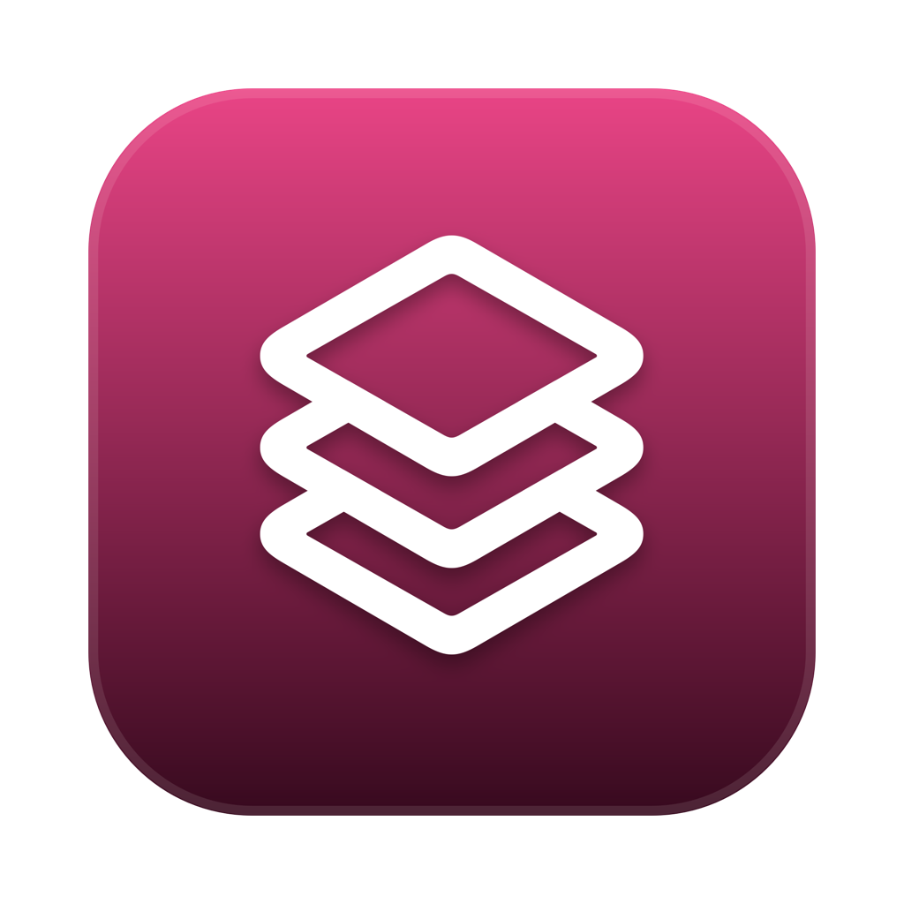

<p align="center">
  
</p>

<h1 align="center">Multiapp</h1>

<p align="center">
  Run the same desktop app several times at once, each copy with its own logins, cookies and settings.<br>
  <a href="../../releases/latest"><b>Download the latest version</b></a>
</p>

<p align="center">
  
  
  
  
</p>

---

## What is Multiapp?

One installed app, several independent profiles. A work Chrome beside a personal one, two Claude accounts,
a second Notion, all from the single copy of the app already on your computer. Each profile signs in on its own and
keeps its own data.

- **Profiles**: create, launch, stop, clone, rename and delete profiles of any supported app
- **Finds your apps by itself**: newly installed apps show up without an update
- **Backup and restore**: save an app's data and put it back; restores never delete what is already there
- **Login sessions**: save just the login (kilobytes, not gigabytes) so a reinstall doesn't mean signing in again
- **Trash**: anything removed goes to a Trash you can restore from
- **Desktop window and command line**: a window app with English / O‘zbekcha / Русский and a dark or light theme, plus a
  `multiapp` command for scripting
- **Leaves your apps alone**: nothing is patched, copied or re-signed, and passwords stored by your computer are never touched

## Download

| Platform | File | Requirements |
|---|---|---|
| Windows | `Multiapp_<version>_x64-setup.exe` (installer) or `Multiapp.exe` (portable) | Windows 10 / 11, 64-bit |
| macOS | `Multiapp_<version>_aarch64.dmg` | A recent macOS on Apple Silicon (M1 or newer) |
| Linux | `multiapp-x86_64-unknown-linux-gnu` | Command line only for now, 64-bit Intel/AMD |

Command-line builds for macOS and Windows (`multiapp-aarch64-apple-darwin`, `multiapp-x86_64-pc-windows-msvc.exe`)
are attached to every release too.

Get them from the [latest release](../../releases/latest).

### Install

**Windows**: run the installer, which adds Multiapp to the Start Menu. The app is not code-signed yet, so SmartScreen
may say "unknown publisher": click *More info → Run anyway*. The portable `Multiapp.exe` needs no install and can add
its own Start Menu shortcut.

**macOS**: open the `.dmg` and drag Multiapp to *Applications*. The first time, right-click the app and choose *Open*
(the app is not notarised yet). If macOS still refuses, run:

```bash
xattr -d com.apple.quarantine /Applications/Multiapp.app
```

**Linux**: download the file, make it executable and run it:

```bash
chmod +x multiapp-x86_64-unknown-linux-gnu
./multiapp-x86_64-unknown-linux-gnu list
```

## Quick start

```console
$ multiapp new "Google Chrome" work
$ multiapp launch "Google Chrome" work
$ multiapp list
APP                PROFILE                STATE
Google Chrome      personal               stopped
Google Chrome      work                   running
$ multiapp stop "Google Chrome" work
```

In the window app it is the same, with buttons.

## Which apps work?

Multiapp works with apps built on Chromium or Electron, which covers a large share of today's desktop apps.

| | Apps |
|---|---|
| **Works** | Google Chrome · Claude · Notion · Notion Calendar · Visual Studio Code · GitHub Desktop · Antigravity · OpenMTP |
| **Partly** | ChatGPT: data is separate, but the account is shared between profiles |
| **Doesn't work** | Native or sandboxed apps such as Telegram, Gemini, ChatGPT Classic |

Every result above comes from actually running the app. For an app that isn't listed, the window app's probe (or `multiapp probe <app>` on macOS)
tests it in about 10 seconds. Backup and login saving work for **any** app, including the ones that can't have profiles.

## Good to know

- Multiapp separates **sessions**, not permissions. It is not a sandbox or a security tool.
- It does not get around licences, seat limits, sign-in or any app's terms. Whether a service allows two accounts is up
  to that service.
- Backups can contain live logins. **Keep them as safe as your passwords.**

## Privacy

Everything runs on your computer. Multiapp has no account, no analytics and no tracking, and never sends your data
anywhere.

## Licence and source

Multiapp is free and open source under the **MIT licence** (see [LICENSE](LICENSE)). The full source code is in this
repository. To build it yourself:

```bash
cd rust && cargo build --release
```

How it works, test results, platform status and the research behind it are in
[docs/TECHNICAL.md](docs/TECHNICAL.md). Windows details are in [WINDOWS.md](WINDOWS.md).

## Feedback

Found a bug or have an idea? [Open an issue](../../issues/new).

---

<sub>Multiapp is not affiliated with any of the apps it launches; their names are used only to describe compatibility.</sub>
